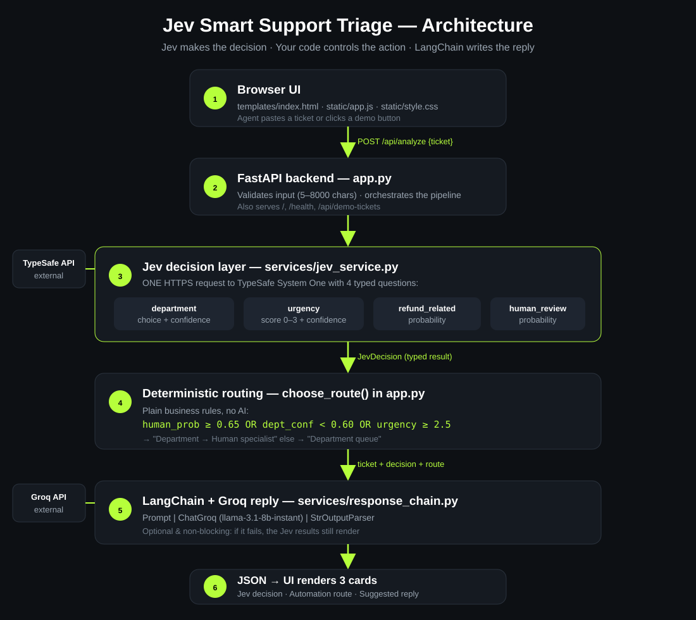

# Jev Smart Support Triage

A small FastAPI demo that triages customer support tickets.

> **Jev makes the decision. Your code controls the action. LangChain writes the reply.**



## What it does

You paste a customer ticket (or click one of the demo tickets). The app returns:

1. **Jev decision layer**: department, urgency (0–3), refund probability and human-review probability.
2. **Deterministic automation**: a final route, such as `Billing queue` or `Technical → Human specialist`.
3. **Suggested reply**: a short customer-facing draft written by an LLM.

## Tech stack

| Layer | Technology |
|---|---|
| Frontend | HTML, CSS, vanilla JavaScript |
| Backend | FastAPI + Uvicorn, Jinja2 templates |
| Decision AI | TypeSafe **Jev** (System One API), called with `httpx` |
| Reply generation | LangChain + Groq (`llama-3.1-8b-instant` by default) |
| Config | `python-dotenv` (`.env` file) |

## Project structure

```
Jev_Poc/
├── app.py                  # FastAPI app, routing rules, API endpoints
├── demo_tickets.json       # 8 sample tickets shown as UI buttons
├── requirements.txt
├── .env                    # your API keys (not committed)
├── services/
│   ├── jev_service.py      # Calls Jev: 4 typed questions in one request
│   └── response_chain.py   # LangChain + Groq reply drafting
├── templates/index.html    # Page layout
├── static/
│   ├── app.js              # Fetches API, fills in the UI
│   └── style.css
└── docs/architecture.svg   # The infographic above
```

## Architecture, step by step

1. **Browser UI**: The agent enters a ticket. `app.js` first loads the demo-ticket buttons from `GET /api/demo-tickets`, which reads `demo_tickets.json`. Clicking *Analyze with Jev* sends `POST /api/analyze` with `{ "ticket": "..." }`.
2. **FastAPI backend (`app.py`)**: Pydantic checks the ticket is 5–8000 characters, then runs the pipeline below. Errors from Jev return HTTP 502.
3. **Jev decision layer (`services/jev_service.py`)**: One HTTPS request to the TypeSafe System One endpoint asks four typed questions at once:
   - `department`: choice of `billing`, `technical`, `account` or `general`, with confidence
   - `urgency`: score (0 Low → 3 Critical), with confidence
   - `refund_related`: probability (`noul` type)
   - `human_review`: probability (`noul` type)

   The response is parsed into a typed `JevDecision` dataclass.
4. **Deterministic routing (`choose_route()` in `app.py`)**: Plain Python rules, with no AI involved. A ticket goes to a human specialist if **any** of these hold:
   - `human_review_probability ≥ 0.65`
   - `department_confidence < 0.60`
   - `urgency_score ≥ 2.5`

   Otherwise it goes to the normal department queue.
5. **LangChain + Groq reply (`services/response_chain.py`)**: The ticket, Jev's decision and the route are put into a prompt (`Prompt | ChatGroq | StrOutputParser`). The prompt tells the model not to promise refunds or fixes, to stay under 120 words, and to say so when the case is escalated. This step is optional. If the key is missing or Groq fails, the Jev results still render and the reply box shows a message.
6. **Response to the UI**: The API returns one JSON object (`jev`, `automation`, `suggested_reply`). `app.js` fills the three result cards.

### Why this split?

| Concern | Handled by | Reason |
|---|---|---|
| Understanding the ticket | Jev | Typed, calibrated outputs (scores and probabilities), not free text |
| Business rules and thresholds | Python code | Predictable, testable, auditable |
| Natural-language wording | LLM (Groq) | Good at prose, kept away from decisions |

## Setup and run

**Prerequisites:** Python 3.10+, a TypeSafe API key, and (optionally) a Groq API key.

```powershell
# 1. Create and activate a virtual environment
python -m venv .venv
.venv\Scripts\Activate.ps1

# 2. Install dependencies
pip install -r requirements.txt

# 3. Create .env in the project root (see below)

# 4. Run
python app.py
```

Open **http://localhost:8080**.

### `.env` settings

```env
TYPESAFE_API_KEY=your_typesafe_api_key      # required
GROQ_API_KEY=your_groq_api_key              # optional (enables the suggested reply)

# Optional overrides (defaults shown)
TYPESAFE_MODEL=jev-latest
TYPESAFE_API_URL=https://api.typesafe.ai/v1/systemone
TYPESAFE_TIMEOUT=30
GROQ_MODEL=llama-3.1-8b-instant
```

## API reference

| Method | Path | Description |
|---|---|---|
| GET | `/` | The web UI |
| GET | `/health` | `{"status": "ok", "version": ...}` |
| GET | `/api/demo-tickets` | Contents of `demo_tickets.json` |
| POST | `/api/analyze` | Body `{"ticket": "..."}`; returns the decision, route and reply |

Example response:

```json
{
  "ticket": "...",
  "jev": {
    "model": "jev-latest",
    "department": "billing",
    "department_confidence": 0.97,
    "urgency_score": 2.1,
    "urgency_confidence": 0.8,
    "refund_probability": 0.95,
    "human_review_probability": 0.3
  },
  "automation": {
    "route": "Billing queue",
    "needs_human": false,
    "reason": "Safe for normal queue routing"
  },
  "suggested_reply": "..."
}
```

## Customizing

- **Add or edit demo tickets:** edit `demo_tickets.json` (`name` and `ticket`) and reload the page.
- **Change routing thresholds:** edit `choose_route()` in `app.py`.
- **Add a new Jev question:** add it to `questions` in `services/jev_service.py` and read it from `answers`.
- **Change the reply tone:** edit `PROMPT` in `services/response_chain.py`.

## Troubleshooting

| Symptom | Fix |
|---|---|
| `TYPESAFE_API_KEY is not configured` | Add the key to `.env` |
| `Jev API error` / HTTP 502 | Check the key, network and `TYPESAFE_API_URL` |
| Reply says Groq is not configured | Add `GROQ_API_KEY`, or ignore it (the reply is optional) |
| SSL certificate error | `app.py` removes an invalid `SSL_CERT_FILE` automatically; check your environment variables |
